**Check Point WAF (CloudGuard AppSec / WAF - Application Security)** is an AI-powered, automated Web Application Firewall and API Security solution managed through the Check Point Infinity Portal. Unlike traditional signature-only WAFs that require constant manual rule tuning and generate high false-positive rates, Check Point WAF uses a dual-engine contextual machine learning model—combining **crowd-based** and **user-behavior** analysis—to automatically detect and prevent OWASP Top 10 attacks, zero-day exploits, API abuse, and malicious bots.

On the **Getting Started** overview in the Infinity Portal, Check Point WAF structures deployment into three core phases:
1. **Define Your Asset**: Register the web applications and APIs you want to protect.
2. **Set Up Enforcement**: Deploy SaaS, Native Controls, AppSec Gateways, Kubernetes Ingress, or Nano Agents to inspect traffic inline.
3. **Monitor Events**: Track security events, API discovery, and machine learning tuning recommendations.

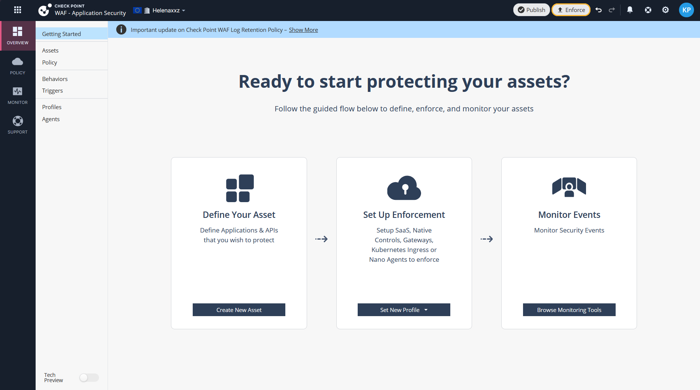

<br>

---

## Deploying On-Premise WAF

To deploy an on-premise WAF reverse proxy, we navigate to **Policy → Profiles** and create a new **AppSec Gateway Profile**.

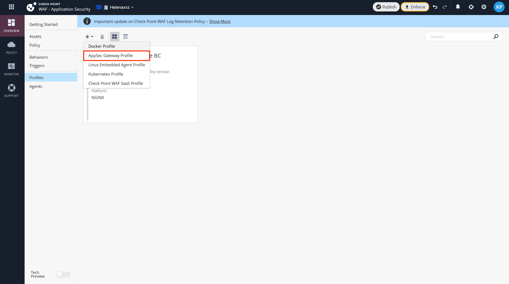

<br>

> **Other Enforcement Profile Options:**
> - **Docker Profile**: Deploys the Check Point Nano Agent as a lightweight container alongside containerized web applications or reverse proxies (e.g., NGINX, Envoy).
> - **Linux Embedded Agent Profile**: Installs the Nano Agent directly on an existing Linux server running NGINX, Apache, or HAProxy.
> - **Kubernetes Profile**: Integrates with Kubernetes Ingress Controllers (such as NGINX Ingress) to protect microservices natively inside a cluster.
> - **Check Point WAF SaaS Profile**: Cloud-hosted WAFaaS where DNS traffic is routed through Check Point's global cloud PoPs without deploying local infrastructure.

---

Inside the **AppSec Gateways** profile, we set the **Environment** to **VMware** and copy the generated **Authentication Token**. This token binds the on-premise Gaia-based AppSec Gateway VM to our Infinity Portal tenant.

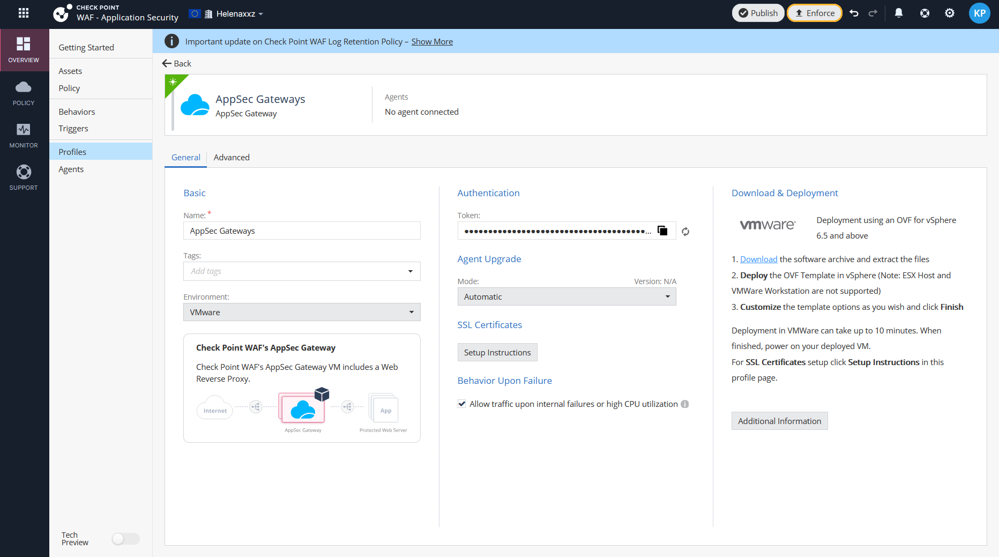

<br>

---

In vSphere, we deploy the Check Point AppSec Gateway OVF template. During the **Customize template** step, we configure the management IP address (`198.18.128.30/18`), Primary DNS (`198.18.128.2`), NTP Server (`198.18.128.3`), and paste the **Infinity Next Agent Token** under Advanced Configuration.

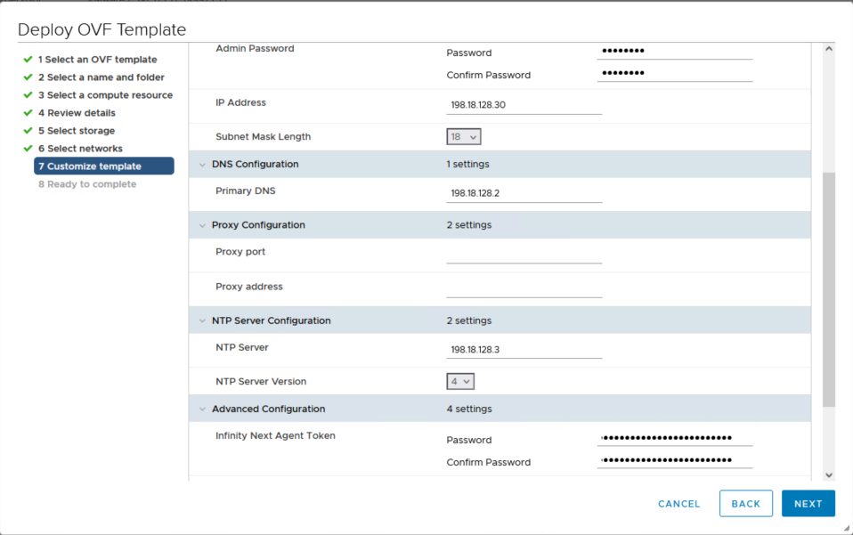

<br>

---

Once the OVF deployment completes, we review the VM hardware summary (`CP_WAF-30` with 4 vCPUs, 8 GB RAM, 100 GB disk) and power on the virtual machine.

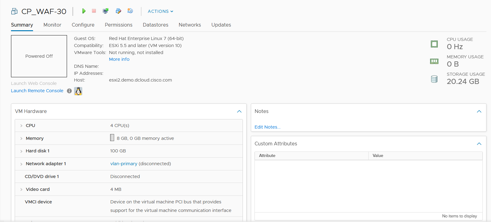

<br>

---

After the VM boots up, we access the expert shell and run `cpnano -s` to verify the Check Point Nano Agent status. Both the **Check Point Nano Agent** and **Check Point Orchestration Nano Service** show `Status: Running`, with `Registration status: Succeeded` and `Manifest status: Succeeded`.

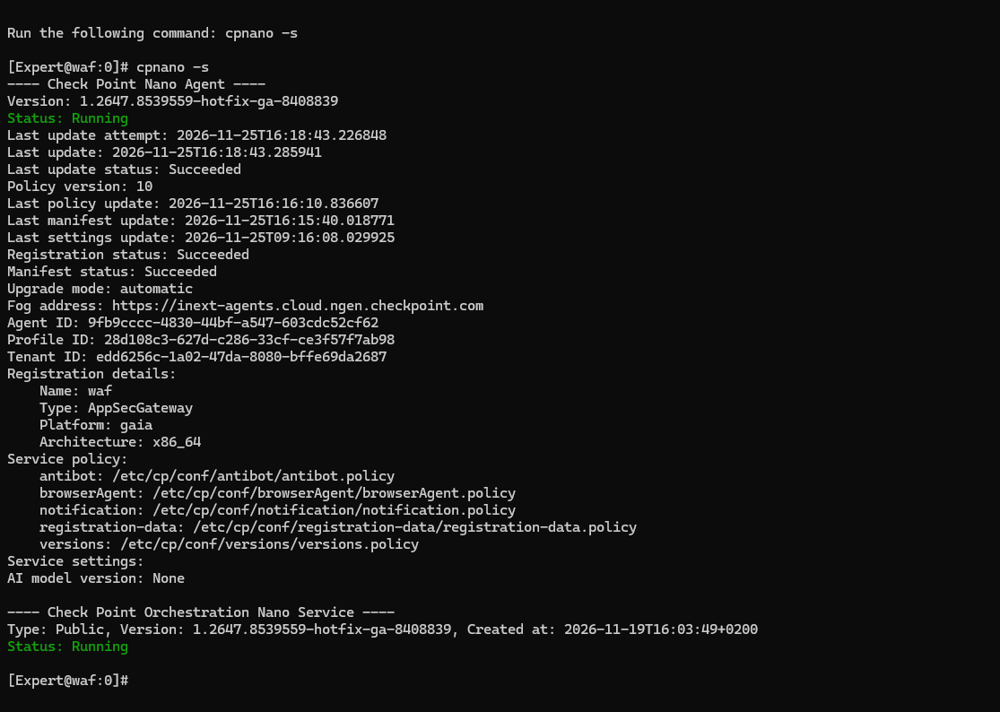

<br>

---

Returning to the Infinity Portal under **Policy → Agents**, the `waf` agent (`198.18.128.30`) appears as **Connected** and synchronized with our `AppSec Gateways` profile.

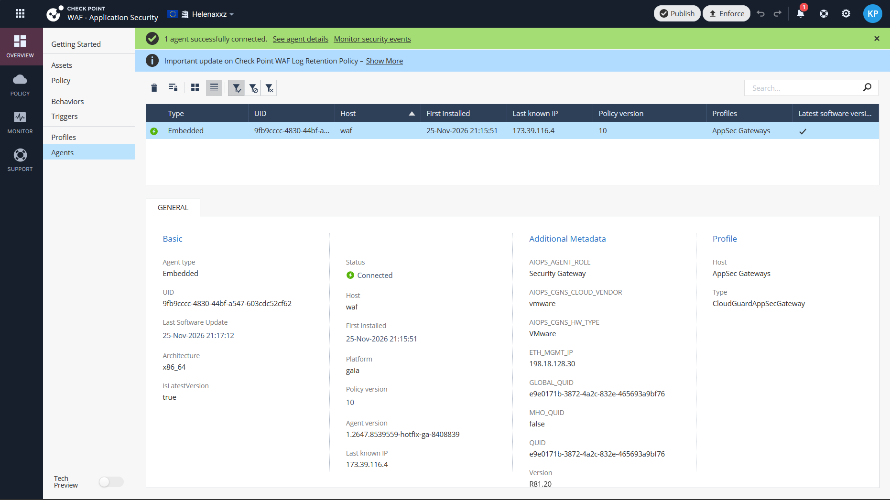

<br>

---

## Configuring Web Servers

For our lab environment, we have five distinct vulnerable/test web applications hosted on `198.18.128.31` across ports `8001`–`8005`, each designed to exercise a specific WAF capability:
- **8001 — ShopStack**: Automatic API discovery (OpenAPI 3.1, discovery headers, JS-referenced endpoints, hidden/internal REST routes).
- **8002 — VaultGate**: Auth + OWASP Top 10 (login injection, reflected XSS, IDOR, open redirect, SSRF sink, access-control bypass).
- **8003 — Sentinel Drop**: Anti-bot (header/UA scoring, honeypot, rate limits, math/JS challenges, robots trap, live dashboard).
- **8004 — FileDrop**: Multipart upload analysis (magic bytes, MIME mismatch, double extensions, traversal filenames, quarantine).
- **8005 — HookMesh**: GraphQL introspection + SSRF simulator (schema discovery, webhooks, private/metadata target classification).

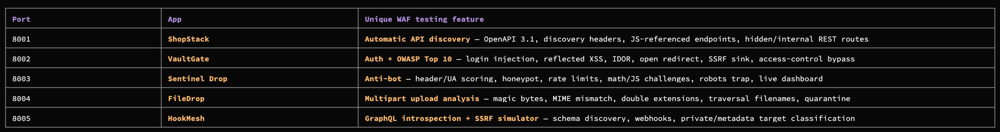

<br>

---

We verify that all five backend web applications are reachable directly on `198.18.128.31` ports `8001` through `8005`.

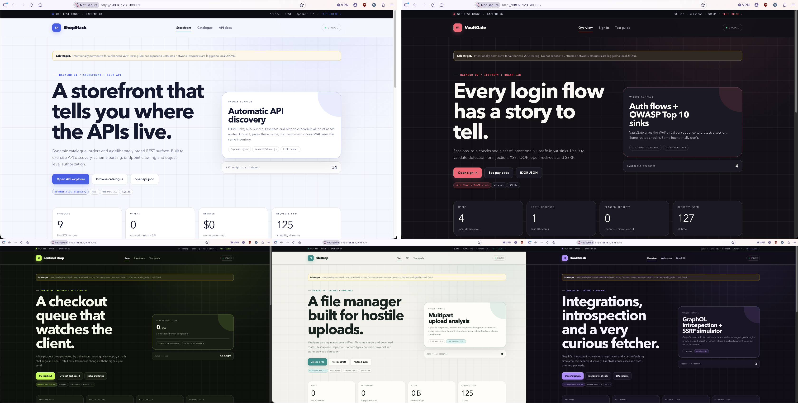

<br>

---

Under **Policy → Assets**, we click **CREATE NEW ASSET** to onboard our first protected web application.

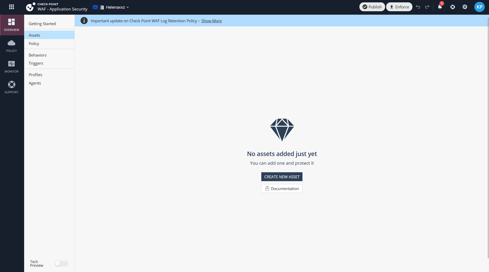

<br>

---

### Asset Creation Wizard

In **Step 1 (Application/API)**, we name the asset `app-8001` and test with simple port mapping on `8001`:
- **Users will access the application / API at these URLs**: `http://198.18.128.30:8001` (the WAF's IP)
- **WAF / Reverse Proxy / Ingress will reach the application / API in this URL**: `http://198.18.128.31:8001` (the backend server)

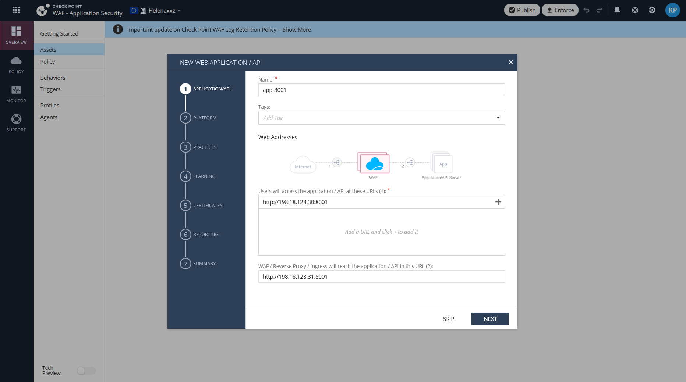

<br>

---

In **Step 2 (Platform)**, we select the **AppSec Gateways** profile configuration, choose **VM** as the deployment method, and select **VMware** as the platform.

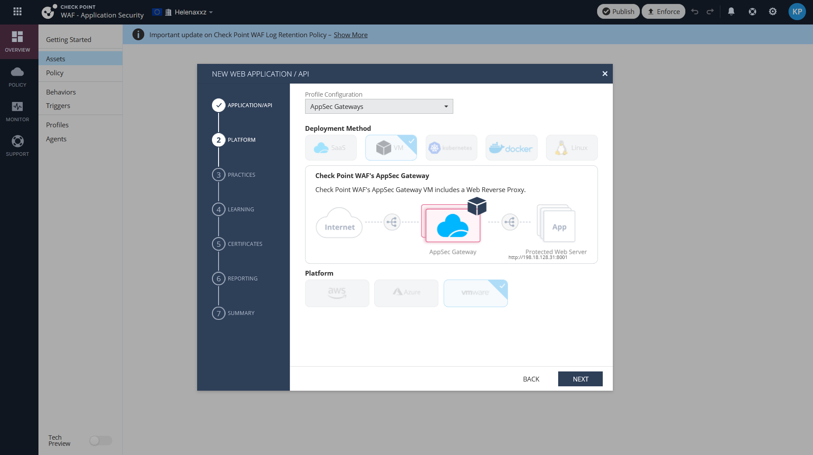

<br>

---

In **Step 3 (Practices)**, we configure the security practices to enforce on the asset:
- **Web Application Security Best Practice** (`Prevent`): Enables **Web Attacks** (ML-based OWASP Top 10 and zero-day protection) and **Intrusion Prevention (IPS)** (2,800+ Web CVEs).
- **API Protection Practice** (`Prevent`): Enables **API Discovery** (`Active`) to automatically map API endpoints from live traffic.

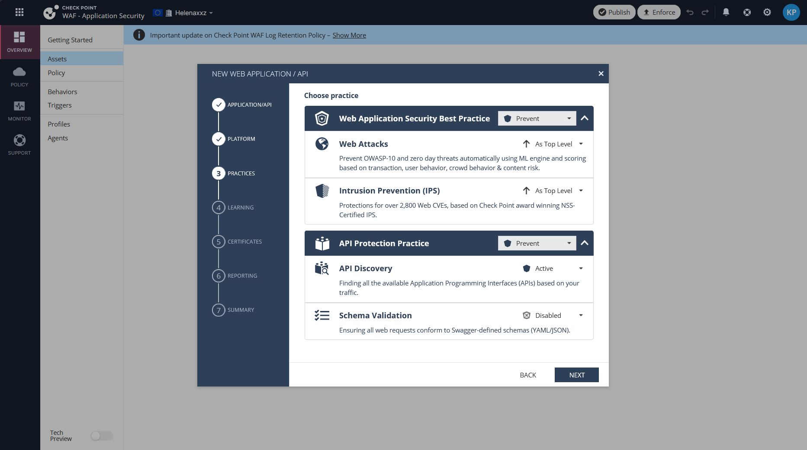

<br>

---

In **Step 4 (Learning)**, we configure how the Learning Engine identifies distinct HTTP clients (`Source IP address`) and optionally specify trusted IPs or users to improve ML baseline accuracy.

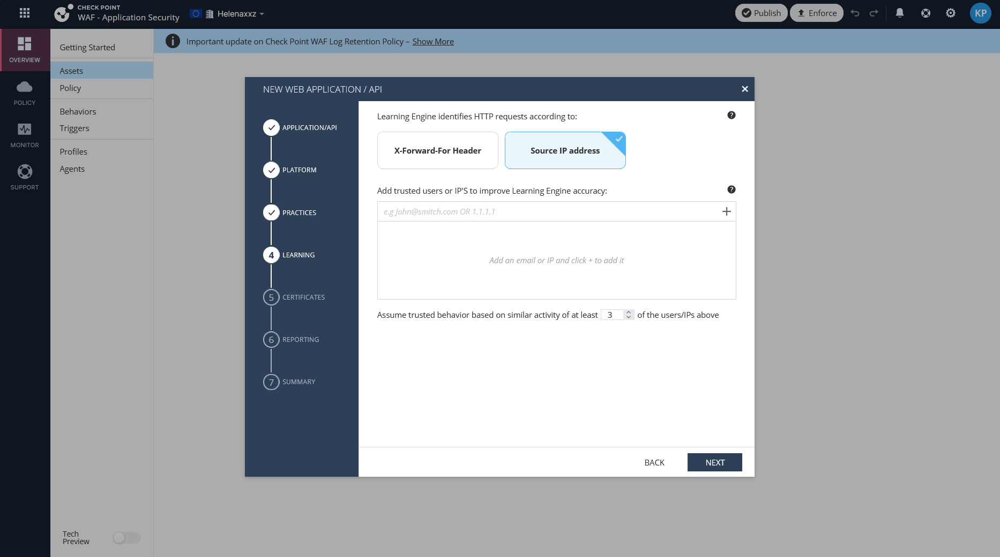

<br>

---

In **Step 5 (Certificates)**, the wizard notes that SSL certificate configuration only applies to HTTPS URLs. Since we are starting with HTTP for initial port-mapping verification, we click **NEXT**.

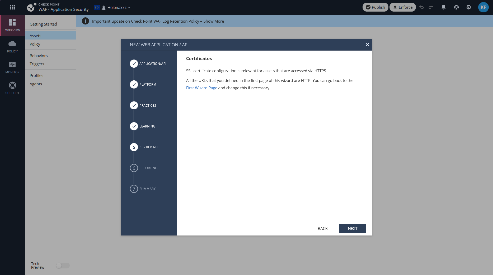

<br>

---

In **Step 6 (Reporting)**, we can configure scheduled daily or weekly executive attack reports to be sent via email.


<br>

---

In **Step 7 (Summary)**, we review the configured Web Protection, API Protection, ML Engine, AppSec Gateway enforcement, and Report Trigger settings, ensure **Publish & Enforce policy** is checked, and click **DONE**.

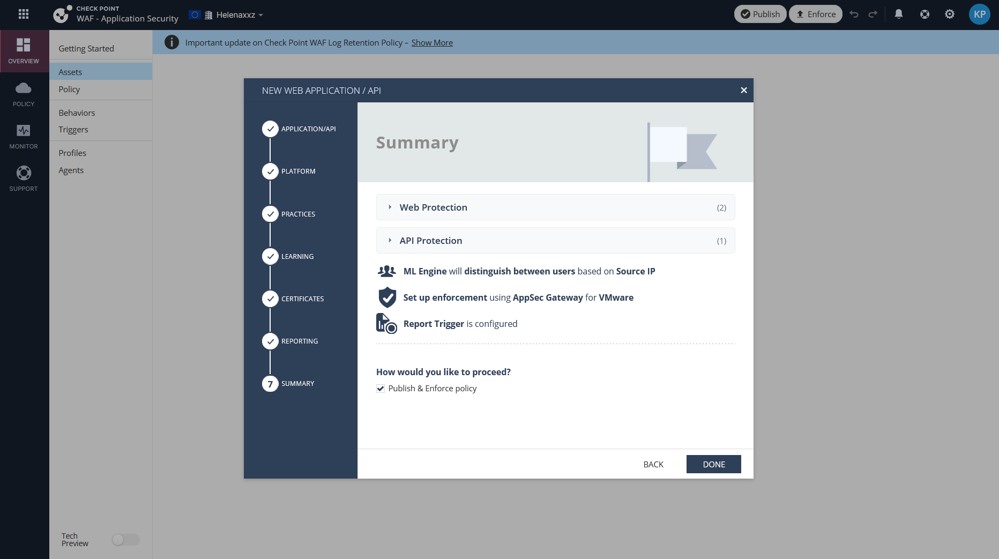

<br>

---

Once enforced, `app-8001` appears active with a green status indicator, bound to `198.18.128.30:8001` and proxying to `http://198.18.128.31:8001`.

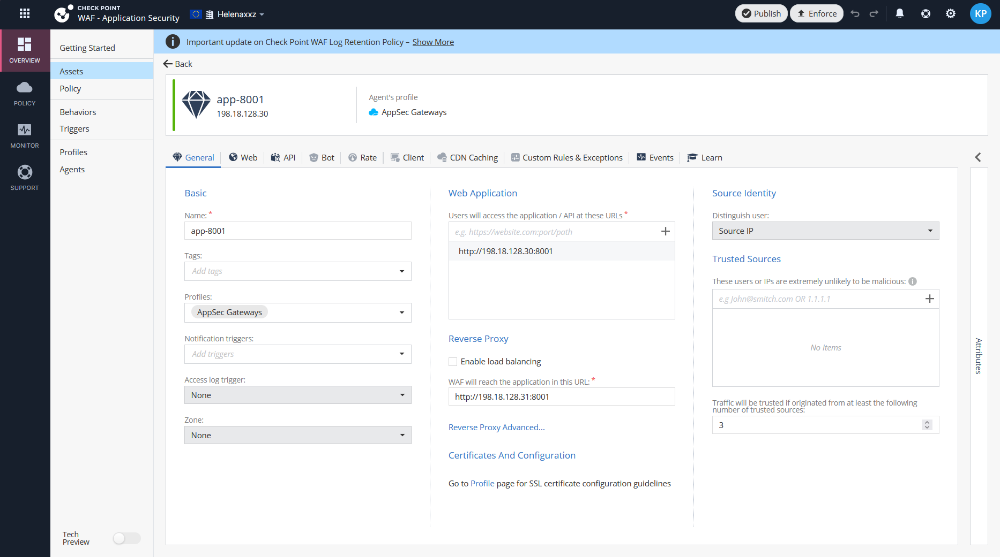

<br>

---

Opening `http://198.18.128.30:8001` in the browser confirms that **ShopStack** is now accessible through the Check Point WAF reverse proxy interface.

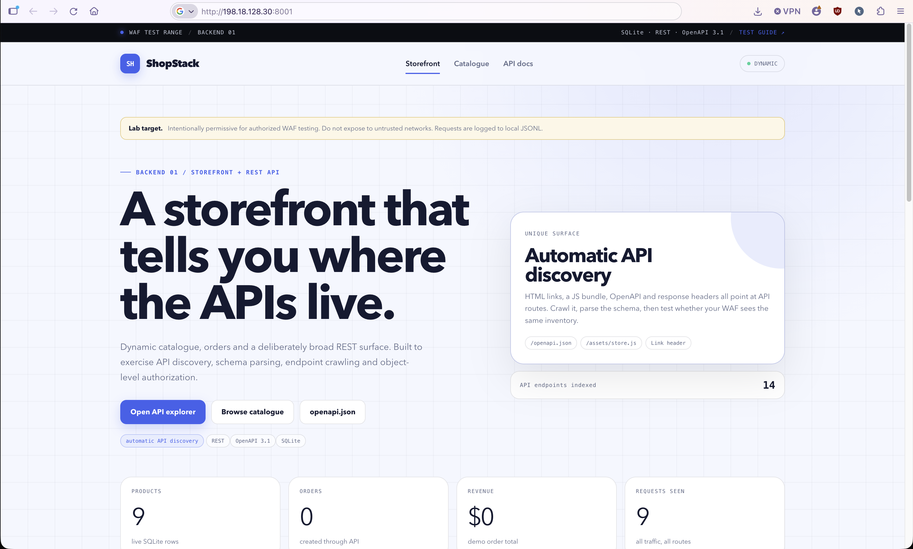

<br>

---

## Configuring VIP

Instead of sharing a single IP address (`198.18.128.30`) with different ports for all five backend servers, we can allocate a dedicated Virtual IP (VIP) to each application by adding IP aliases to `eth0` on the Check Point WAF CLI:

```
add interface eth0 alias 198.18.128.81/24
add interface eth0 alias 198.18.128.82/24
add interface eth0 alias 198.18.128.83/24
add interface eth0 alias 198.18.128.84/24
add interface eth0 alias 198.18.128.85/24
save config
```

Running `show configuration interface` confirms all five VIP aliases are active on `eth0`.

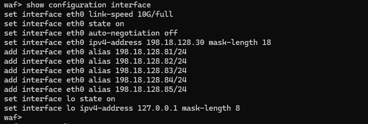

<br>

---

We update `app-8001` so that users access it via `http://198.18.128.81` (standard port 80), while the WAF continues forwarding traffic to `http://198.18.128.31:8001` on the backend.

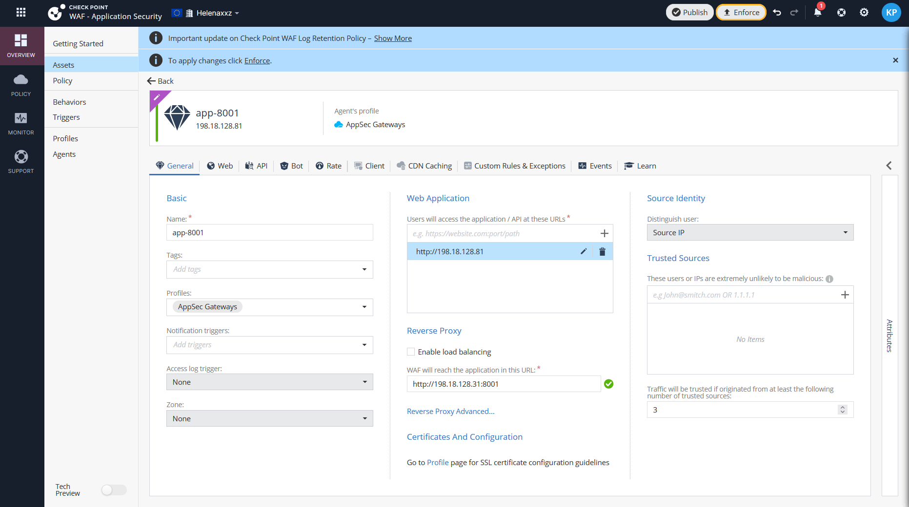

<br>

---

We repeat this process for the remaining four applications, assigning each its own dedicated VIP:
- `app-8001` → `198.18.128.81`
- `app-8002` → `198.18.128.82`
- `app-8003` → `198.18.128.83`
- `app-8004` → `198.18.128.84`
- `app-8005` → `198.18.128.85`

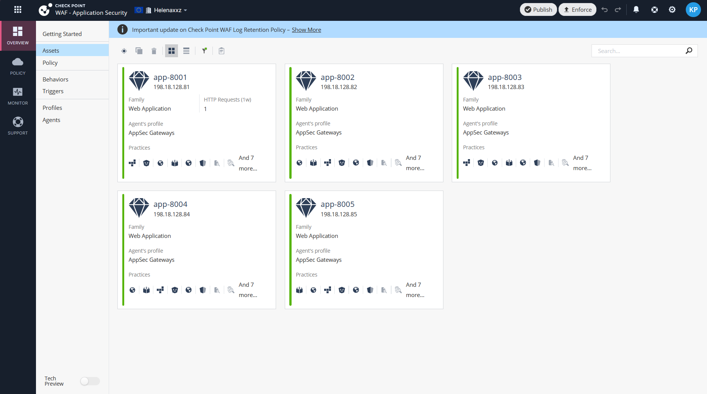

<br>

---

Navigating to **Policy → Policy**, we can see that the security policy rules—including **Web Application Best Practice**, **API Protection Practice**, **Anti Bot Practice**, **Log/Report Triggers**, and **AppSec Gateways** enforcement—are automatically created for each asset.

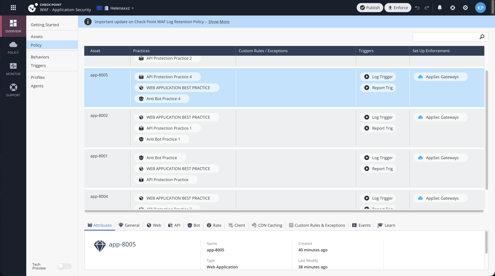

<br>

---

Testing in the browser confirms all five backend applications are now cleanly accessible via their respective dedicated VIPs (`198.18.128.81` through `198.18.128.85`).

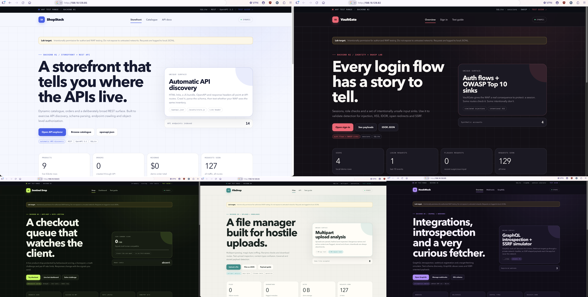

<br>

---

## SSL Offloading

Next, we enable HTTPS with SSL offloading on the WAF so client traffic is encrypted end-to-end while the WAF inspects decrypted payloads inline.

First, we generate a Certificate Signing Request (CSR) and RSA 2048-bit private key for `*.waf.helena.gg`, including Subject Alternative Names (SANs) for `*.waf.helena.gg`, `waf.helena.gg`, and all five VIPs (`198.18.128.81`–`198.18.128.85`).

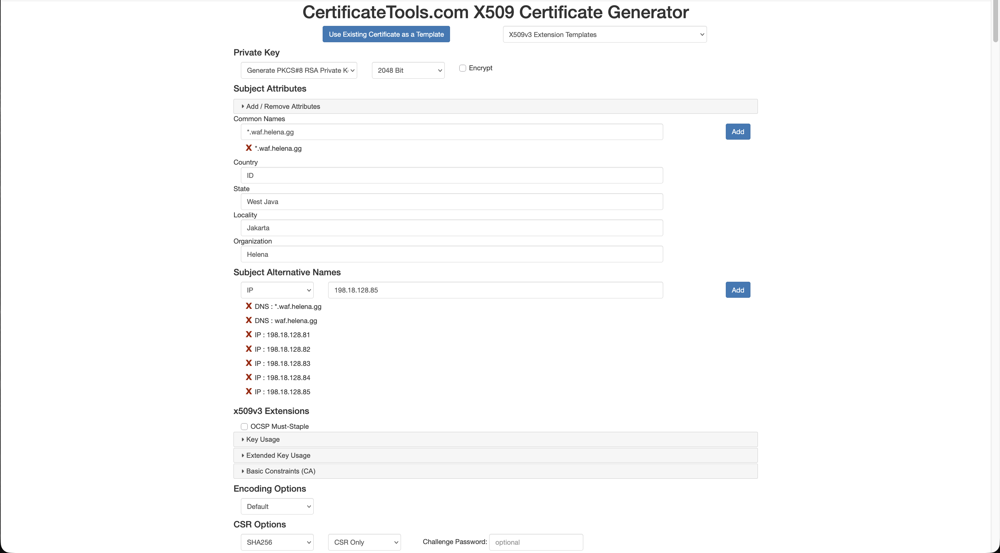

<br>

---

We submit the CSR to our internal Microsoft Active Directory Certificate Services (`helena-CA`) using the **Web Server** template and include the SAN attributes.

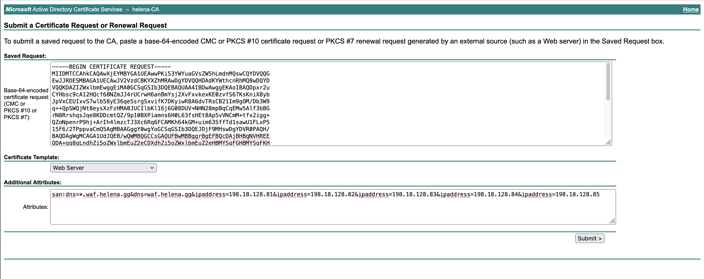

<br>

---

Check Point AppSec Gateway requires SSL certificates to be packaged using Check Point's `certverify` tool. On a Linux host containing `waf.pem` and `waf.key`, we run:

```bash
./certverify --cert waf.pem --key waf.key
```

The tool verifies the certificate and key pair and outputs `/root/waf/waf_waf.pkg`.

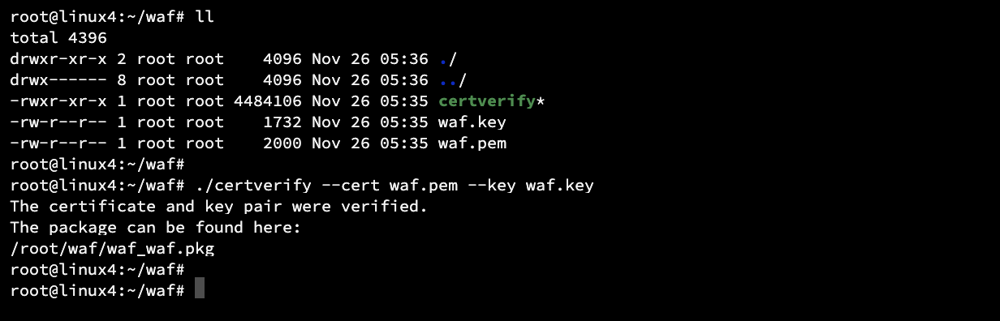

<br>

---

We copy the generated `waf_waf.pkg` package over to `/etc/certs/` on the Check Point WAF appliance using `scp`:

```bash
scp waf_waf.pkg admin@198.18.128.30:/etc/certs/
```

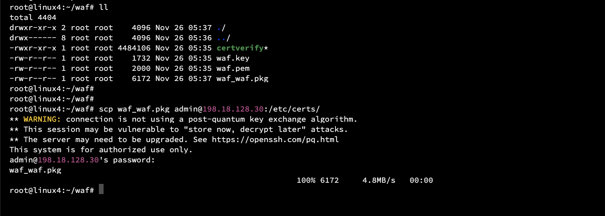

<br>

---

In the Infinity Portal, we update each asset's public URLs from `http://` to `https://`—for example, `https://198.18.128.81` and `https://app1.waf.helena.gg`—while keeping the backend reverse proxy connection on HTTP (`http://198.18.128.31:8001`).

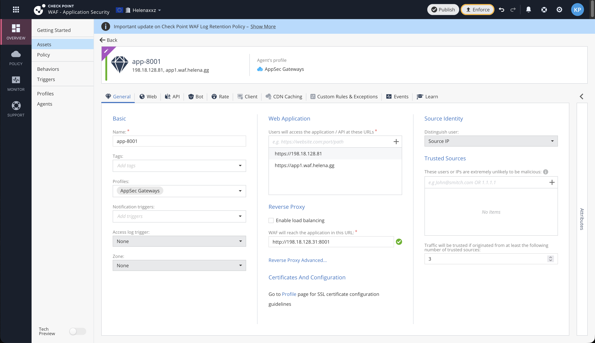

<br>

---

All five assets (`app-8001` through `app-8005`) are now updated with their respective VIPs and FQDNs (`app1.waf.helena.gg` through `app5.waf.helena.gg`) and enforced.

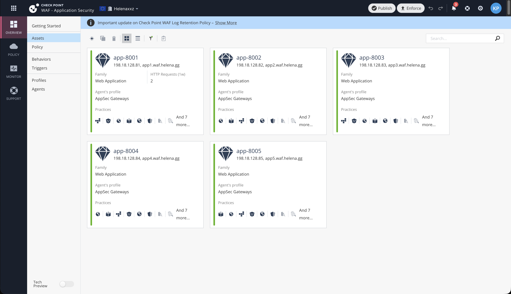

<br>

---

Accessing `https://app3.waf.helena.gg` in the browser confirms that the site is served over HTTPS with a valid certificate verified by `helena-CA`.

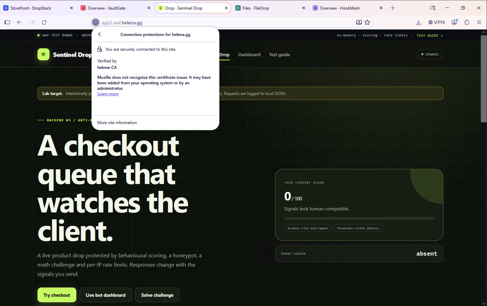

<br>

---

## Testing & Monitoring

We run a comprehensive test suite against all five protected backends, sending both legitimate requests and simulated attacks (SQLi, XSS, API probing, path traversal, metadata SSRF, rate bursts, malicious file uploads, and GraphQL mutations). Every legitimate request (`5/5`) is allowed with `200 OK` / `201`, while `60+` attack probes are consistently blocked by the WAF with `403`.

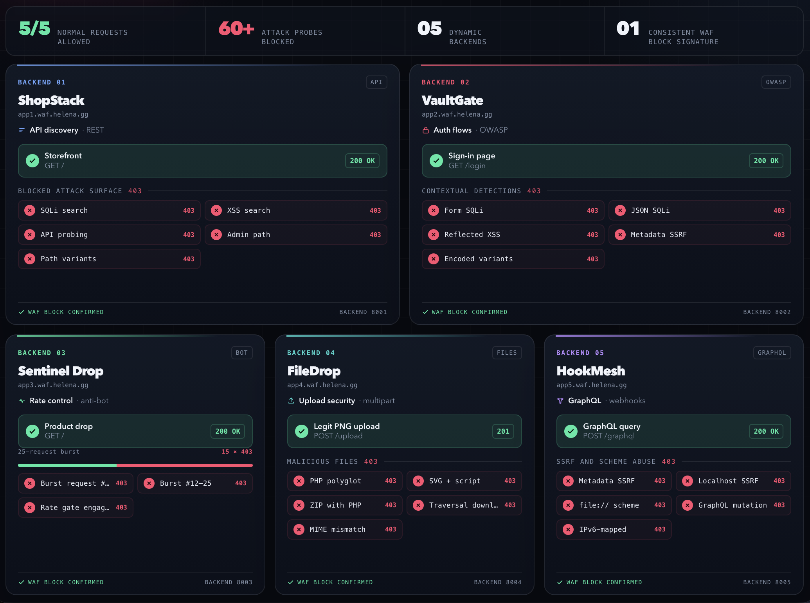

<br>

---

Under **Monitor → WAF Dashboard**, we get a real-time overview of HTTP traffic (`563` requests), malicious activity (`4` assets targeted), and security actions (`212` Prevents, `0` Detects), along with Top Attack Sources, Attacks Timeline, Attacks Level breakdown (`87.7%` Critical, `12.3%` High), and per-asset statistics.

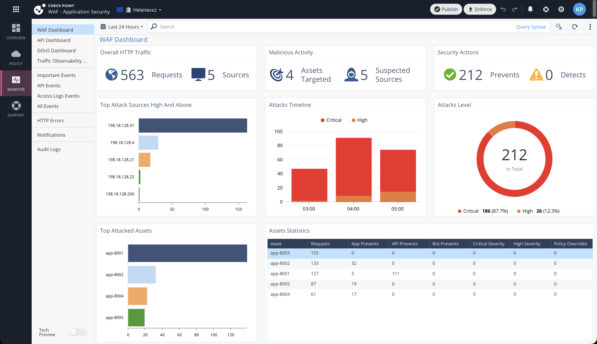

<br>

---

Under **Monitor → API Dashboard**, Check Point WAF visualizes API traffic (`2.8K` API Requests, `2.4K` Malicious API Requests), lists the **Most Used** and **Least Used** APIs, and automatically catalogs newly discovered **API Endpoints** across our assets.

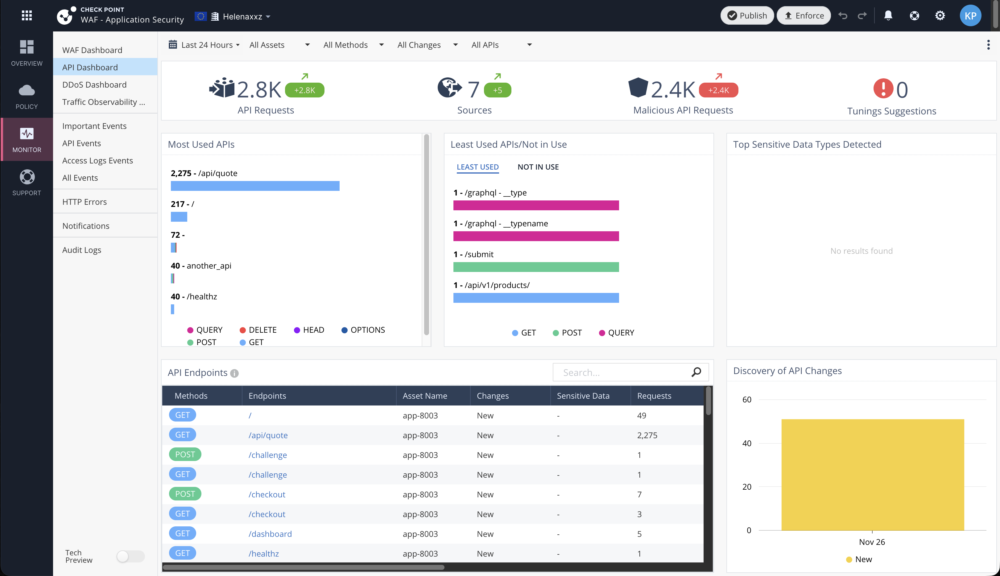

<br>

---

Drilling down into **Malicious API Requests** from the API Dashboard reveals detailed event logs showing `Critical` and `High` severity incidents—such as Remote Code Execution, Path Traversal, Vulnerability exploit attempts, Cross Site Scripting, and SQL Injection—all mitigated with `Prevent`.

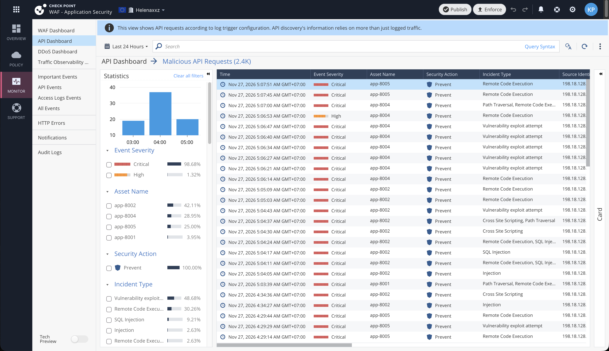

<br>

---

Under **Monitor → Important Events**, we can inspect high-priority security events across all assets, filtered by Event Severity, Asset Name, Security Action (`Prevent`), and Incident Type (Schema Validation, Vulnerability exploit, Authentication Enforcement, Remote Code Execution, Rate Limit, and SQL Injection).

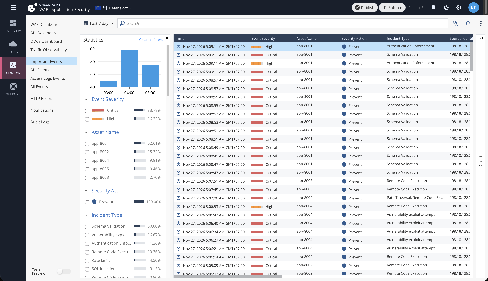

<br>

---

Finally, each asset includes a dedicated **Learn** tab that tracks the machine learning engine's progress (Elapsed Time, Learning Level, and Recommendation) and provides **Supervised Learning** tuning suggestions—allowing administrators to review undecided events and mark sources as **Malicious** or **Benign** to continuously refine detection accuracy.

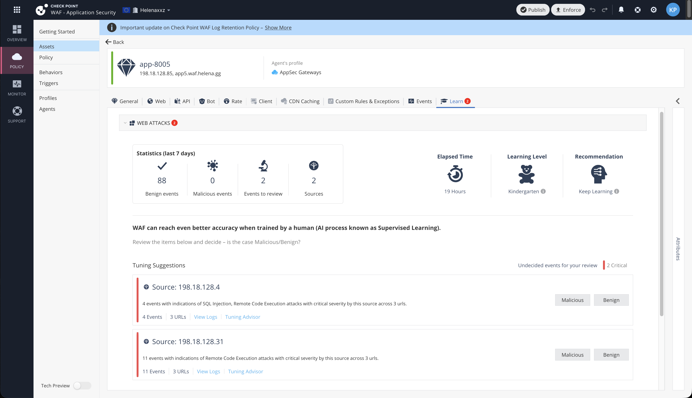
